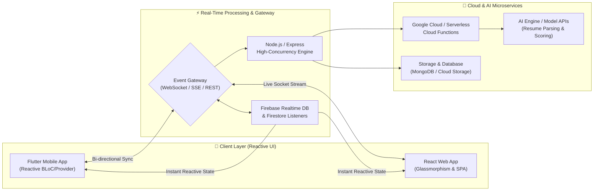
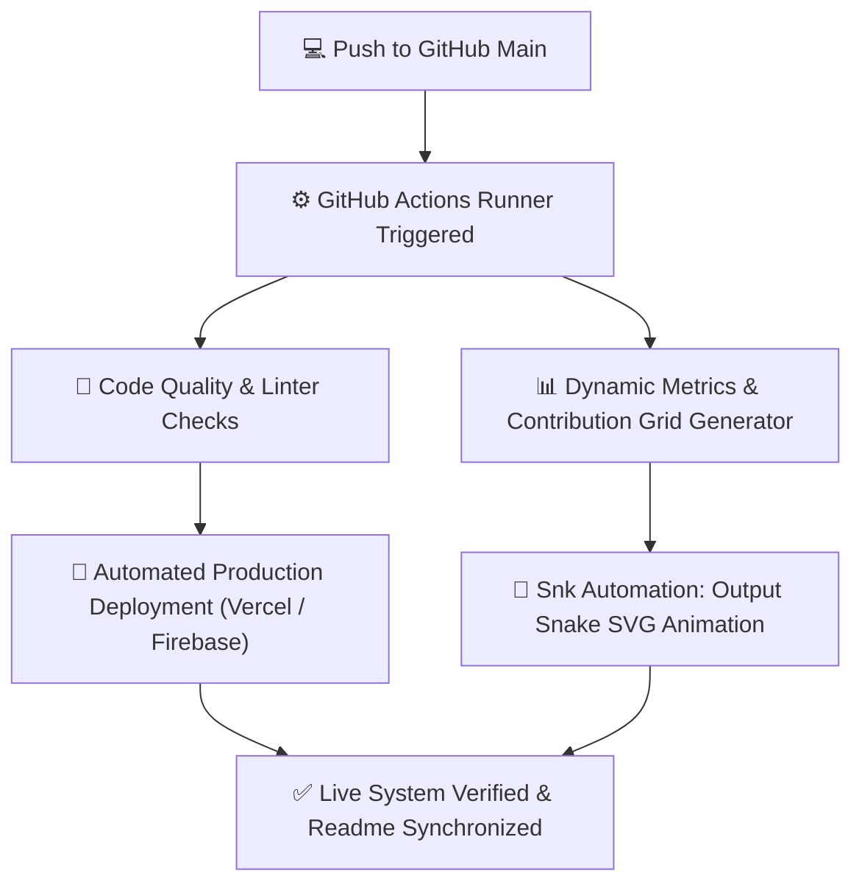

<div align="center">

<!-- ========================================== -->
<!-- 🚀 ULTRA-ADVANCED HERO BANNER -->
<!-- ========================================== -->


<!-- ========================================== -->
<!-- ⚡ DYNAMIC LIVE TYPING SVG -->
<!-- ========================================== -->
<a href="https://github.com/Yokeshkumar-tech">
  
</a>

<br/>

<!-- ========================================== -->
<!-- 🛰️ REAL-TIME SYSTEM TELEMETRY BADGES -->
<!-- ========================================== -->
<p align="center">
  
  
  
  
</p>

<!-- Quick Social Links Bar -->
<p align="center">
  <a href="https://www.linkedin.com/in/yokesh-kumar"></a>
  <a href="mailto:yokeshkumar217@gmail.com"></a>
  <a href="https://github.com/Yokeshkumar-tech"></a>
  
</p>

</div>

---

## 💻 `developer.terminal` — Real-Time Environment State

```typescript
/**
 * Real-Time Developer State & Telemetry Matrix
 * Initialized by Yokesh Kumar
 */
import { FullStackDeveloper, CloudArchitect, Innovator } from "@yokesh/core";

export const YokeshKumar: FullStackDeveloper = {
  profile: {
    name: "Yokesh Kumar",
    title: "Full Stack Engineer & Cross-Platform Mobile Specialist",
    education: "B.Tech – Information Technology (2023–2027)",
    institution: "Nadar Saraswathi College of Engineering & Technology",
    location: "Allinagaram, Theni, Tamil Nadu 🇮🇳",
    contact: {
      email: "yokeshkumar217@gmail.com",
      github: "https://github.com/Yokeshkumar-tech",
      linkedin: "https://www.linkedin.com/in/yokesh-kumar"
    }
  },

  runtimeStatus: {
    engine: "V8 & Dart VM",
    architecture: "Event-Driven Microservices & Reactive Frontends",
    stateSync: "Active (WebSocket / Firebase Realtime DB / SSE)",
    isCoding: true,
    coffeeLevel: "100%",
    uptime: "24/7 Builder Mindset 🚀"
  },

  activeEngines: [
    "Flutter / Dart (Cross-Platform Mobile Apps)",
    "React.js & Next.js (Dynamic Rich UI Web Systems)",
    "Node.js & Express.js (High-Throughput REST & Socket APIs)",
    "Firebase & Cloud Firestore (Real-Time Reactive Backends)",
    "Python & Java (Algorithms & Automated Pipelines)"
  ],

  executeCoreLoop: async () => {
    while (true) {
      await learnLatestTech();
      await architectScalableCode();
      await shipDelightfulProducts();
    }
  }
};
```

---

## ⚡ Real-Time Processing Architecture & Pipelines

This pipeline illustrates how I architect and process asynchronous real-time events across mobile, web, cloud microservices, and AI models:



### 🔄 Automated CI/CD & Dynamic Metric Life Cycle



---

## 📊 Live GitHub Real-Time Analytics

<div align="center">

<table>
  <tr>
    <td width="50%" align="center">
      <a href="https://github.com/Yokeshkumar-tech">
        
      </a>
    </td>
    <td width="50%" align="center">
      <a href="https://github.com/Yokeshkumar-tech">
        
      </a>
    </td>
  </tr>
  <tr>
    <td colspan="2" align="center">
      <a href="https://github.com/Yokeshkumar-tech">
        
      </a>
    </td>
  </tr>
  <tr>
    <td colspan="2" align="center">
      <a href="https://github.com/Yokeshkumar-tech">
        
      </a>
    </td>
  </tr>
</table>

</div>

---

## 🏆 Real-Time GitHub Trophies

<div align="center">

[](https://github.com/Yokeshkumar-tech)

</div>

---

## 🛠️ Advanced Tech Arsenal & Core Proficiencies

<div align="center">

### 💻 Languages & Scripting
<p>
  
  
  
  
  
  
</p>

### ⚛️ Frontend & Cross-Platform Mobile
<p>
  
  
  
  
  
</p>

### ⚡ Backend, Cloud & Real-Time Engines
<p>
  
  
  
  
  
</p>

### 🛠️ Developer Tools, Design & DevOps
<p>
  
  
  
  
  
</p>

</div>

---

## 💼 Featured Engineering Projects

<div align="center">

| Project & Concept | Architecture & Stack | Real-Time Process & Key Innovations | Links |
|:---|:---|:---|:---:|
| **🤖 AI-Powered Resume Builder**<br/>*Next-Gen Intelligent Career Utility* | `Flutter` • `Firebase` • `Cloud Firestore` • `AI Model Integration` | ⚡ Real-time cloud sync with Cloud Firestore<br/>⚡ Instant reactive PDF preview engine<br/>⚡ Automated AI keyword & skills evaluation | [Explore Project](https://github.com/Yokeshkumar-tech) |
| **📚 Real-Time Flashcard Learning Engine**<br/>*Interactive Spaced-Repetition Platform* | `React.js` • `Node.js` • `Express` • `RESTful API` | ⚡ Live study session telemetry & stats<br/>⚡ Instant deck generation & progress analytics<br/>⚡ Dynamic state synchronization | [Explore Project](https://github.com/Yokeshkumar-tech) |
| **🚦 Smart Traffic Optimization Simulation**<br/>*Adaptive Algorithmic Signal System* | `Python` • `Queue Theory` • `Real-Time Algorithmic Logic` | ⚡ Dynamic density-weighted vehicle queue balancing<br/>⚡ Priority emergency signal preemption<br/>⚡ Live traffic congestion heat reduction | [Explore Project](https://github.com/Yokeshkumar-tech) |
| **🌐 Telemetry-Powered Portfolio Portal**<br/>*Ultra-Rich Glassmorphic Web App* | `HTML5` • `Vanilla CSS Engine` • `Modern JavaScript ES6+` | ⚡ Real-time GitHub API data synchronization<br/>⚡ Ultra-smooth micro-animations & dark aesthetic<br/>⚡ Lightweight zero-dependency performance | [Explore Project](https://github.com/Yokeshkumar-tech) |

</div>

---

## 🎓 Academic Foundation & Verified Certifications

<div align="center">

### 🏛️ Education Timeline

| Degree / Program | Alma Mater | Timeline | Current Status |
|:---|:---|:---:|:---:|
| **B.Tech – Information Technology** | Nadar Saraswathi College of Engineering & Technology | 2023 – 2027 | 🟢 Active Pursuing (Top Tier Focus) |
| **Higher Secondary Examination (HSC - 12th)** | Nadar Saraswathi Boys Higher Secondary School | 2020 – 2022 | ✅ Graduated with Distinction |

<br/>

### 🎖️ Engineering Certifications & Competencies

| Domain | Credential | Focus & Validation |
|:---:|:---|:---|
| ⚛️ | **React JS Certified** | Component Lifecycle, Hooks, State Architecture & High-Performance Rendering |
| ☕ | **Java Fundamentals Certified** | OOP Principles, Multi-threading, Data Structures & Algorithmic Design |
| 🔧 | **Git & Distributed Version Control** | Branching Workflows, Rebase Mechanics, Team Collaboration & CI/CD |
| 🐍 | **Python Core Certified** | Functional Programming, Scripting, Automation & Data Manipulation |
| 🤝 | **Collaborative Agile Engineering** | Agile Scrum, High-Impact Communication, Cross-Functional Teamwork |
| 🧩 | **Complex Problem Solving** | Algorithmic Optimization, Edge-case Analysis & Clean Code Principles |

</div>

---

## 🔍 Deep-Dive Interactive Modules

<details>
<summary><b>⚡ View Real-Time WebSocket & Data Synchronization Lifecycle</b></summary>
<br/>

```
[Client App] ──(1) Connect Handshake──> [WebSocket Gateway / Node Server]
    │                                              │
    ├──(2) Authenticate (JWT / Firebase Auth)─────>│
    │                                              ├───> [Redis Pub/Sub]
    │<──(3) Connection Verified & State Hydrated───┤
    │                                              │
    ├──(4) Real-Time User Event Dispatched────────>│
    │                                              ├───> [Database Mutation]
    │<──(5) Instant Broadcast State Update─────────┤
```

- **Optimistic UI Updates:** State mutations render instantaneously on the client while syncing with backend microservices asynchronously.
- **Auto-Reconnection:** Built-in exponential backoff ensures zero data loss during network disruptions.
- **Security:** Token-based authorization verified on every socket packet.

</details>

<details>
<summary><b>🐍 View Automated GitHub Contribution Snake Workflow</b></summary>
<br/>

This repository is optimized for automated GitHub Actions workflows. To enable the live snake contribution animation in your profile, set up `.github/workflows/snake.yml`:

```yaml
name: Generate Snake Contribution Grid

on:
  schedule:
    - cron: "0 0 * * *" # Runs daily at midnight
  workflow_dispatch:

jobs:
  build:
    runs-on: ubuntu-latest
    steps:
      - uses: actions/checkout@v3
      - uses: Platane/snk@v3
        with:
          github_user_name: Yokeshkumar-tech
          outputs: |
            dist/github-contribution-grid-snake.svg
            dist/github-contribution-grid-snake-dark.svg?palette=github-dark
      - uses: crazy-max/ghaction-github-pages@v3.1.0
        with:
          target_branch: output
          build_dir: dist
        env:
          GITHUB_TOKEN: ${{ secrets.GITHUB_TOKEN }}
```

</details>

<details>
<summary><b>🚀 Active Tech Roadmap & Innovation Queue</b></summary>
<br/>

```
✦ [Q1] Cloud Native Architectures ──> Containerization & Docker Microservices
✦ [Q2] High-Performance Flutter   ──> Custom Shaders & Advanced Canvas Renderers
✦ [Q3] Full-Stack AI Pipelines     ──> LLM Function Calling, RAG & Vector Embeddings
✦ [Q4] Real-Time Distributed Tech ──> WebRTC, gRPC & Distributed Event Streams
```

</details>

---

## 📬 Connect & Collaborate with Me

<div align="center">

Ready to collaborate on high-impact projects, real-time architectures, or cutting-edge applications? Feel free to reach out!

<br/>

<a href="https://www.linkedin.com/in/yokesh-kumar">
  
</a>
&nbsp;
<a href="https://github.com/Yokeshkumar-tech">
  
</a>
&nbsp;
<a href="mailto:yokeshkumar217@gmail.com">
  
</a>
&nbsp;
<a href="https://github.com/Yokeshkumar-tech">
  
</a>

<br/><br/>


<p align="center">
  <b>Designed with ❤️ and Precision by Yokesh Kumar</b><br/>
  <i>"Code. Build. Ship. Repeat. 🚀"</i>
</p>

</div>
