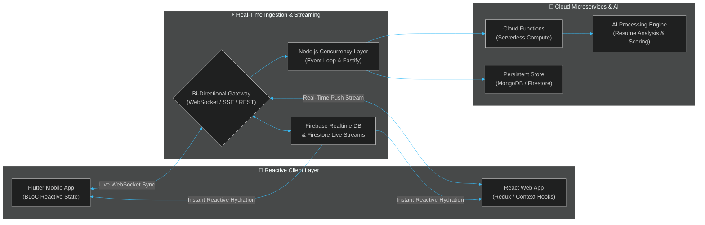
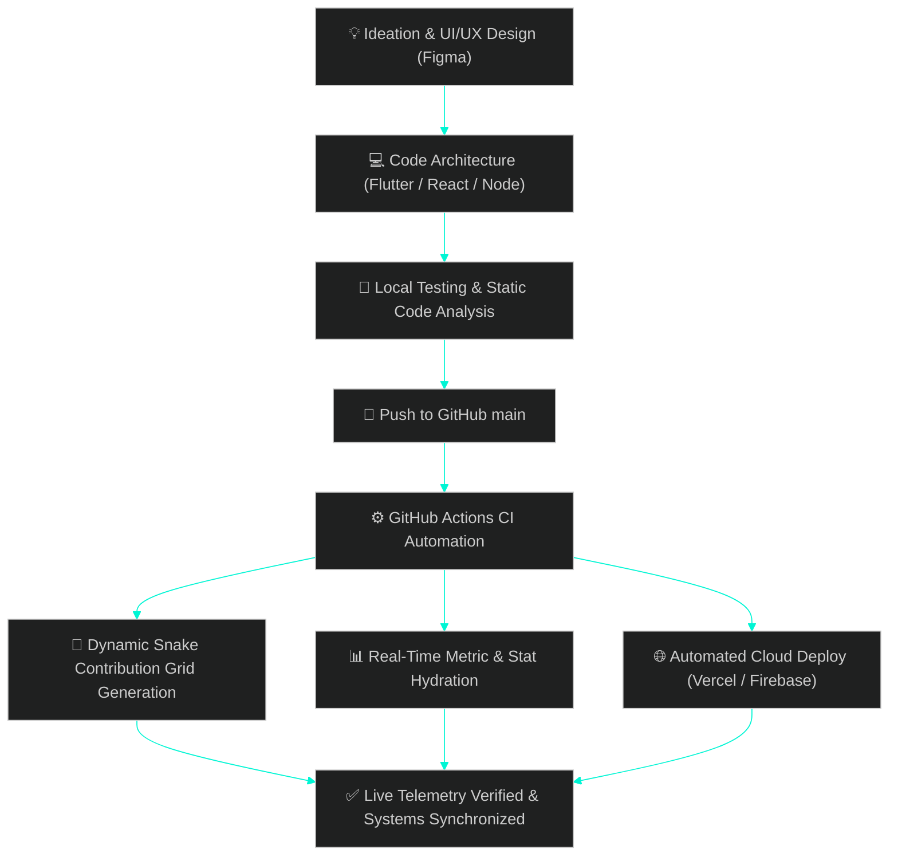

<div align="center">

<!-- ============================================================ -->
<!-- 🚀 ULTRA-SLEEK CYBER OBSIDIAN HEADER (RICH UI) -->
<!-- ============================================================ -->


<!-- ============================================================ -->
<!-- ⚡ CRISP SINGLE-LINE REAL-TIME TYPING ENGINE (NO CLIPPING) -->
<!-- ============================================================ -->
<a href="https://github.com/Yokeshkumar-tech">
  
</a>

<br/>

<!-- ============================================================ -->
<!-- 🛰️ UNIFIED TELEMETRY HUD BAR -->
<!-- ============================================================ -->
<p align="center">
  
  
  
  
</p>

<!-- Quick Action & Connect Strip -->
<p align="center">
  <a href="https://www.linkedin.com/in/yokesh-kumar" target="_blank"></a>
  &nbsp;
  <a href="mailto:yokeshkumar217@gmail.com"></a>
  &nbsp;
  <a href="https://github.com/Yokeshkumar-tech"></a>
  &nbsp;
  
</p>

</div>

---

## ⚡ FULL REAL-TIME PROCESS ARCHITECTURE

This section details the **end-to-end asynchronous event pipelines** and the **automated continuous delivery processes** that power my applications:

### 1️⃣ Real-Time Data Streaming & Event Processing Pipeline



---

### 2️⃣ Full Engineering & CI/CD Delivery Process



---

## 💻 `developer.terminal` — Environment & Runtime State

<details open>
<summary><b>View Live Environment Telemetry</b></summary>
<br/>

```typescript
/**
 * Developer State Matrix & Real-Time Specifications
 * Profile: Yokesh Kumar
 */
export const developerState = {
  engineer: {
    name: "Yokesh Kumar",
    role: "Full Stack Engineer & Mobile Systems Architect",
    degree: "B.Tech – Information Technology (2023–2027)",
    college: "Nadar Saraswathi College of Engineering & Technology",
    base: "Allinagaram, Theni, Tamil Nadu, India 🇮🇳",
    availability: "Open to High-Impact Engineering Roles & Collaborations 🚀"
  },

  liveProcesses: {
    eventLoop: "Active (Node.js v20+ / Dart VM)",
    dataSync: "WebSocket streams & Firestore reactive listeners",
    stateManagement: "BLoC (Flutter) • Redux / Context (React)",
    optimizationTarget: "Sub-100ms real-time latency & zero-jank rendering"
  },

  coreArsenal: [
    "Flutter / Dart", "React.js / Next.js", "Node.js / Express",
    "Firebase Suite", "Python", "Java", "REST / WebSockets", "Git / CI-CD"
  ],

  executionLoop: async () => {
    while (true) {
      await solveComplexProblems();
      await buildRealTimeArchitectures();
      await deliverDelightfulExperiences();
    }
  }
};
```

</details>

---

## 💼 FEATURED PROJECTS — FULL PROCESS BREAKDOWN

<div align="center">

| Project & Concept | Architecture Stack | Full Real-Time Process Flow | Links |
|:---|:---|:---|:---:|
| **🤖 AI-Powered Resume Builder**<br/>*Intelligent ATS Optimization Utility* | `Flutter`<br/>`Firebase Firestore`<br/>`Cloud Storage`<br/>`AI Model APIs` | **1. Input:** User profiles & career experience<br/>**2. Process:** Cloud OCR parsing & ATS scoring algorithm<br/>**3. Output:** Instant reactive PDF preview & cloud sync | [Explore Repository](https://github.com/Yokeshkumar-tech) |
| **📚 Real-Time Flashcard Learning Engine**<br/>*Interactive Spaced-Repetition Platform* | `React.js`<br/>`Node.js / Express`<br/>`WebSockets`<br/>`RESTful APIs` | **1. Input:** User flashcard decks & quiz responses<br/>**2. Process:** Live WebSocket quiz broadcast & spaced repetition<br/>**3. Output:** Real-time leaderboard updates & retention curves | [Explore Repository](https://github.com/Yokeshkumar-tech) |
| **🚦 Smart Traffic Optimization System**<br/>*Adaptive Algorithmic Preemption* | `Python`<br/>`Queueing Theory`<br/>`Simulation Logic`<br/>`Sensor Data` | **1. Input:** Multi-lane vehicle density & queue telemetry<br/>**2. Process:** Dynamic queue balancing & emergency preemption<br/>**3. Output:** Real-time signal switching & congestion mitigation | [Explore Repository](https://github.com/Yokeshkumar-tech) |
| **🌐 Telemetry-Powered Portfolio Portal**<br/>*Ultra-Rich Glassmorphic Experience* | `HTML5`<br/>`Vanilla CSS Engine`<br/>`Modern JavaScript`<br/>`GitHub API` | **1. Input:** Live visitor interactions & GitHub telemetry<br/>**2. Process:** Asynchronous REST API hydration & micro-animations<br/>**3. Output:** Lightweight, 60fps responsive web application | [Explore Repository](https://github.com/Yokeshkumar-tech) |

</div>

---

## 📊 LIVE REAL-TIME GITHUB ANALYTICS

<div align="center">

<table border="0" cellpadding="0" cellspacing="0">
  <tr>
    <td width="50%" align="center">
      <a href="https://github.com/Yokeshkumar-tech">
        
      </a>
    </td>
    <td width="50%" align="center">
      <a href="https://github.com/Yokeshkumar-tech">
        
      </a>
    </td>
  </tr>
  <tr>
    <td colspan="2" align="center">
      <a href="https://github.com/Yokeshkumar-tech">
        
      </a>
    </td>
  </tr>
  <tr>
    <td colspan="2" align="center">
      <a href="https://github.com/Yokeshkumar-tech">
        
      </a>
    </td>
  </tr>
</table>

<br/>

[](https://github.com/Yokeshkumar-tech)

</div>

---

## 🛠️ TECH STACK ARSENAL

<div align="center">

### 💻 Programming Languages
<p>
  
  
  
  
  
  
</p>

### ⚛️ Frontend & Cross-Platform Mobile
<p>
  
  
  
  
</p>

### ⚡ Backend, Cloud & Real-Time Infrastructure
<p>
  
  
  
  
  
</p>

### 🛠️ Developer Tools & DevOps
<p>
  
  
  
  
  
</p>

</div>

---

## 🎓 ACADEMIC FOUNDATION & CERTIFICATIONS

<div align="center">

| Milestone | Institution | Period | Focus & Honors |
|:---|:---|:---:|:---|
| **B.Tech – Information Technology** | Nadar Saraswathi College of Engineering & Technology | 2023 – 2027 | Full-Stack Engineering, Cloud Computing, Algorithms |
| **Higher Secondary Examination (12th)** | Nadar Saraswathi Boys Higher Secondary School | 2020 – 2022 | Mathematics & Computer Science Distinction |

<br/>

| Certificate | Verification Body | Focus Area |
|:---:|:---|:---|
| ⚛️ | **React JS Certified** | State Architecture, Component Lifecycle & Hooks |
| ☕ | **Java Fundamentals Certified** | OOP Principles, Multi-threading & Algorithmic Design |
| 🔧 | **Git & GitHub Certified** | Version Control, Distributed Branching & Collaboration |
| 🐍 | **Python Certified** | Functional Scripting, Automation & Backend Basics |

</div>

---

## 🔍 INTERACTIVE REAL-TIME MODULES

<details>
<summary><b>⚡ Deep-Dive: WebSocket & Real-Time Sync State Machine</b></summary>
<br/>

```
[Mobile/Web Client] ────( Handshake )────> [WebSocket Gateway]
         │                                       │
         ├───( Authenticate Token )─────────────>│
         │                                       ├───> [Redis Pub/Sub Channel]
         │<──( Connection Established )──────────┤
         │                                       │
         ├───( Real-Time State Mutation )───────>│
         │                                       ├───> [Cloud Firestore Update]
         │<──( Instant Broadcast Update )────────┤
```

- **Optimistic Rendering:** Client applies local UI updates immediately with zero latency, rolling back only if server rejects.
- **Bi-Directional Channels:** Live synchronization of quiz participants, resume changes, and collaborative states.

</details>

<details>
<summary><b>🐍 Deep-Dive: Automated Snake Contribution Grid CI/CD</b></summary>
<br/>

Daily cron workflow in `.github/workflows/snake.yml` generates the animated SVG on every contribution push:

```yaml
name: Generate Snake Contribution Grid
on:
  schedule:
    - cron: "0 0 * * *"
  workflow_dispatch:
  push:
    branches: [ main ]
jobs:
  build:
    runs-on: ubuntu-latest
    steps:
      - uses: actions/checkout@v3
      - uses: Platane/snk@v3
        with:
          github_user_name: Yokeshkumar-tech
          outputs: |
            dist/github-contribution-grid-snake.svg
            dist/github-contribution-grid-snake-dark.svg?palette=github-dark
      - uses: crazy-max/ghaction-github-pages@v3.1.0
        with:
          target_branch: output
          build_dir: dist
        env:
          GITHUB_TOKEN: ${{ secrets.GITHUB_TOKEN }}
```

</details>

---

## 📬 CONNECT & COLLABORATE

<div align="center">

<a href="https://www.linkedin.com/in/yokesh-kumar">
  
</a>
&nbsp;
<a href="https://github.com/Yokeshkumar-tech">
  
</a>
&nbsp;
<a href="mailto:yokeshkumar217@gmail.com">
  
</a>

<br/><br/>


<p align="center">
  <b>Designed with Precision by Yokesh Kumar</b><br/>
  <i>"Code. Build. Ship. Repeat. 🚀"</i>
</p>

</div>
